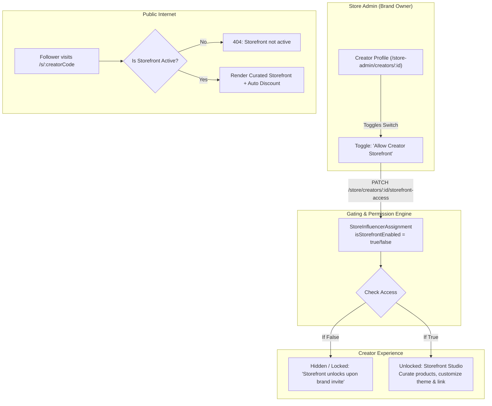

# Influencer Storefront Feature Specification (Gated / Admin-Controlled)

**Keyword Trigger**: `INFLUENCER_STOREFRONT` (or `#STOREFRONT-V1`)  
**Status**: Future Development Architecture & Implementation Blueprint  
**Access Model**: Hidden / Gated / Invite-Only (Store Admin Gatekeeper)

---

## 1. Overview & Concept

An **Influencer Storefront** is a personalized, high-converting "Link-in-Bio" shopping page (e.g., `megainfluencer.in/s/:creatorCode` or `/storefront/:creatorCode`) where creators curate their favorite brand products, feature their personal recommendations, and provide followers with an exclusive discount code.

### 🔑 Critical Business Constraint: Admin-Controlled Gating
* **Hidden Feature**: The storefront feature is **NOT** exposed to all creators by default.
* **Store Admin Gatekeeper**: Only the **Store Admin (Brand Owner)** has the authority to unlock and enable the storefront privilege for specific creators.
* **Gated UI**:
  * If access is not granted, the feature is hidden or displays a locked "Invite-Only Beta" state in the Creator Portal.
  * If access is granted by at least one store, the creator gets access to the **Storefront Studio** to curate products, organize shelves, customize themes, and share their bio link.
* **Public Route Guard**: Visiting `/s/:creatorCode` for an unapproved or disabled creator returns a 404 / "Storefront not active".

---

## 2. Core Pillars & Architecture



---

## 3. Database Schema Blueprint (`prisma/schema.prisma`)

### 3.1 Update `StoreInfluencerAssignment`
Add gating and scope control directly to the assignment between the store and creator:
```prisma
model StoreInfluencerAssignment {
  id                    String       @id @default(cuid())
  organizationId        String
  influencerId          String
  compensationMode      String       @default("COMMISSION")
  
  // ---> STOREFRONT GATING FIELDS <---
  isStorefrontEnabled   Boolean      @default(false) // Toggle controlled strictly by Store Admin
  storefrontAccessScope String       @default("ASSIGNED_ONLY") // 'ASSIGNED_ONLY' or 'FULL_CATALOG'
  storefrontEnabledAt   DateTime?

  organization          Organization @relation(fields: [organizationId], references: [id], onDelete: Cascade)
  influencer            User         @relation("AssignedInfluencer", fields: [influencerId], references: [id], onDelete: Cascade)
  createdAt             DateTime     @default(now())

  @@unique([organizationId, influencerId])
  @@index([influencerId])
}
```

### 3.2 Add `CreatorStorefront`
Houses creator-level customization, theme, branding, and publication status:
```prisma
model CreatorStorefront {
  id              String   @id @default(cuid())
  creatorId       String   @unique
  creator         User     @relation(fields: [creatorId], references: [id], onDelete: Cascade)
  slug            String   @unique // Matches creatorCode or custom vanity slug
  
  // Customization & Appearance
  title           String?  // e.g. "Priya's Curated Edit"
  tagline         String?  // e.g. "Clean beauty & aesthetic home finds"
  bio             String?
  bannerImageUrl  String?
  themeColor      String   @default("#7c3aed")
  layoutStyle     String   @default("GRID") // GRID | EDITORIAL | COMPACT
  socialLinks     Json?    // [{ platform: "instagram", url: "..." }]
  
  isPublished     Boolean  @default(true)
  showPromoBanner Boolean  @default(true)
  
  // Shelves & Products
  shelves         StorefrontShelf[]
  products        StorefrontProductItem[]
  
  viewCount       Int      @default(0)
  createdAt       DateTime @default(now())
  updatedAt       DateTime @updatedAt

  @@index([slug])
  @@index([creatorId])
}

model StorefrontShelf {
  id           String                  @id @default(cuid())
  storefrontId String
  storefront   CreatorStorefront       @relation(fields: [storefrontId], references: [id], onDelete: Cascade)
  title        String                  // e.g. "My Morning Routine", "Under ₹999"
  description  String?
  position     Int                     @default(0)
  items        StorefrontProductItem[]
  createdAt    DateTime                @default(now())
  updatedAt    DateTime                @updatedAt

  @@index([storefrontId, position])
}

model StorefrontProductItem {
  id           String            @id @default(cuid())
  storefrontId String
  storefront   CreatorStorefront @relation(fields: [storefrontId], references: [id], onDelete: Cascade)
  shelfId      String?
  shelf        StorefrontShelf?  @relation(fields: [shelfId], references: [id], onDelete: SetNull)
  productId    String
  product      ShopifyProduct    @relation(fields: [productId], references: [id], onDelete: Cascade)
  
  customNote   String?           // Personal creator endorsement (e.g. "My daily holy grail!")
  badge        String?           // "TOP PICK", "MUST HAVE", "DAILY USE"
  position     Int               @default(0)
  isFeatured   Boolean           @default(false)
  
  createdAt    DateTime          @default(now())
  updatedAt    DateTime          @updatedAt

  @@unique([storefrontId, productId])
  @@index([storefrontId, shelfId, position])
}
```

---

## 4. API Endpoints Specification

### 4.1 Store Admin Endpoints (`backend/src/modules/store/creators.routes.ts`)
* `PATCH /store/creators/:creatorId/storefront-access`
  * **Auth**: `STORE_OWNER`
  * **Payload**:
    ```json
    {
      "enabled": true,
      "accessScope": "ASSIGNED_ONLY" // or "FULL_CATALOG"
    }
    ```
  * **Actions**:
    1. Updates `StoreInfluencerAssignment.isStorefrontEnabled`.
    2. Ensures creator has a unique `creatorCode`.
    3. Provisions `CreatorStorefront` record if not already present.
    4. Sends notification to creator: *"🎉 [Brand Name] unlocked your personal Creator Storefront!"*
  * **Response**: `{ ok: true, isStorefrontEnabled: true, storefrontUrl: string }`

### 4.2 Influencer Studio Endpoints (`backend/src/modules/influencer-storefront/`)
* `GET /influencer/storefront`
  * **Auth**: `INFLUENCER`
  * **Logic**: Checks if any store assignment has `isStorefrontEnabled === true`.
  * **Response**:
    * If false: `{ hasAccess: false }`
    * If true: `{ hasAccess: true, storefront: {...}, availableStores: [...], availableProducts: [...] }`
* `PUT /influencer/storefront`
  * **Payload**: `{ title, bio, bannerImageUrl, themeColor, layoutStyle, socialLinks, isPublished }`
* `POST /influencer/storefront/shelves` & `DELETE /influencer/storefront/shelves/:id`
  * Add, rename, or reorder shelves.
* `POST /influencer/storefront/products`
  * Add a product to a shelf with personal note/badge.
* `DELETE /influencer/storefront/products/:id`
  * Remove a product from the storefront.

### 4.3 Public Storefront Endpoint (`backend/src/modules/affiliate-links/` or new public router)
* `GET /api/v1/storefronts/:slug`
  * **Auth**: Public (No auth needed, cached for speed)
  * **Validation**:
    1. Finds creator by `creatorCode` or vanity slug.
    2. Validates that at least one partner store has `isStorefrontEnabled === true`.
    3. If invalid/disabled: returns `404 Not Found` with `{ active: false }`.
  * **Response**:
    ```json
    {
      "creator": {
        "displayName": "Priya Sharma",
        "creatorCode": "PRIYA10",
        "avatarUrl": "...",
        "bio": "Daily skincare and lifestyle recommendations",
        "socialLinks": [{ "platform": "instagram", "url": "https://instagram.com/priya" }]
      },
      "storefront": {
        "title": "Priya's Curated Edit",
        "bannerImageUrl": "...",
        "themeColor": "#7c3aed",
        "layoutStyle": "GRID"
      },
      "promoBanner": {
        "code": "PRIYA10",
        "discountText": "Use code PRIYA10 for 15% off at checkout"
      },
      "shelves": [
        {
          "id": "shelf-1",
          "title": "Morning Routine",
          "products": [
            {
              "id": "prod-1",
              "title": "Botanical Renewal Serum",
              "price": "₹1,899",
              "imageUrl": "...",
              "badge": "HOLY GRAIL",
              "customNote": "I use this every single morning without fail.",
              "affiliateUrl": "/r/botanical-serum"
            }
          ]
        }
      ]
    }
    ```

---

## 5. Frontend Implementation Blueprint

### 5.1 Store Admin UI: Gating Controls
* **File**: `frontend/src/routes/store-admin/creators/$creatorId.tsx`
* **Card Component**: `CreatorStorefrontAccessCard`:
  * Switch: **"Enable Creator Storefront"** (Green active badge vs Muted inactive).
  * Radio Group: Catalog Permission (*"Assigned Products Only"* vs *"Full Store Catalog"*).
  * Live URL Box: `megainfluencer.in/s/PRIYA10` with Copy Button & External Link to preview.
  * Performance Metric: GMV and Orders driven via this creator's storefront.

### 5.2 Influencer Portal UI: Storefront Studio
* **Route**: `/influencer/store` (or dedicated `/influencer/storefront`).
* **Locked State** (when `hasAccess === false`):
  * Sleek Glassmorphic Card: *"Creator Storefront (Invite Only Beta)"*.
  * *"Storefronts are currently enabled by partner brands. Once a brand owner enables your storefront, you can curate your favorite products and share a single link in your bio."*
* **Unlocked Studio** (when `hasAccess === true`):
  * **Live Mobile Preview Frame**: Right-side phone mockup showing live changes as the creator styles their storefront.
  * **Product Catalog Drawer**: Search and select products from partner brands.
  * **Shelf Builder**: Add shelves, drag and reorder.
  * **Personal Touch Modal**: Add personal recommendation note (*"Why I recommend this"*) and badge.
  * **Share Drawer**: 1-click Instagram Bio link copy, QR code download.

### 5.3 Public Storefront Page (`/s/$creatorCode`)
* **Route**: `frontend/src/routes/s/$creatorCode.tsx`.
* **Mobile-First Design**:
  * Verified Creator Header + Cover photo.
  * Sticky Promo Code Banner with 1-tap copy toast (*"Code PRIYA10 copied! Auto-applying at checkout."*).
  * Shelf Pills / Category Tabs for quick filtering.
  * Product Cards with creator's quote, retail price, and *"Buy Now"* button.
  * Attribution Redirection: Every click triggers `/r/:slug` to ensure attribution and cart discount application.

---

## 6. Ready-to-Execute Checklist when Triggered

When resuming work using keyword `INFLUENCER_STOREFRONT`:
1. [ ] **Step 1**: Apply Prisma schema changes in `backend/prisma/schema.prisma` & run `npx prisma db push`.
2. [ ] **Step 2**: Add `PATCH /store/creators/:creatorId/storefront-access` endpoint in `backend/src/modules/store/creators.routes.ts`.
3. [ ] **Step 3**: Add storefront toggle switch in `frontend/src/routes/store-admin/creators/$creatorId.tsx`.
4. [ ] **Step 4**: Implement `GET /api/v1/storefronts/:slug` with access validation.
5. [ ] **Step 5**: Create public route `frontend/src/routes/s/$creatorCode.tsx` with mobile-first storefront UI.
6. [ ] **Step 6**: Implement Creator Storefront Studio in `frontend/src/features/influencer/`.
