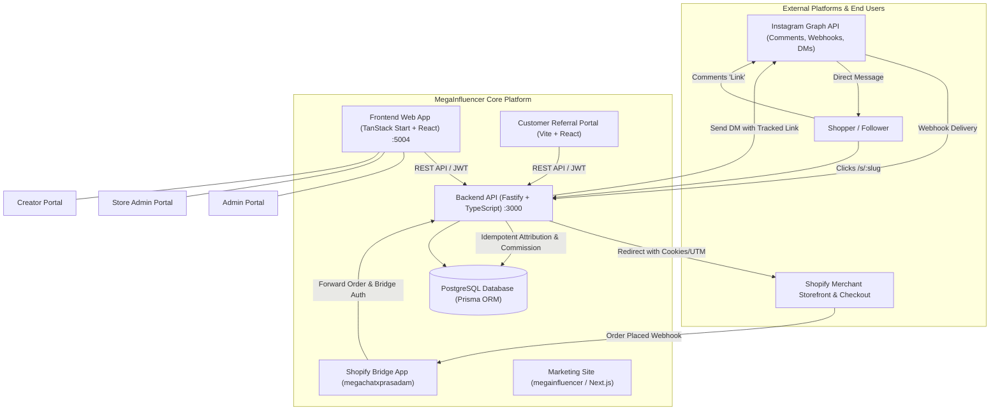

# MegaInfluencer — Comprehensive System Architecture & Codebase Map

> **Single Source of Truth for Architecture, Modules, Data Models, Workflows, and File Registry.**  
> *Notice for Developers and AI Agents*: Whenever modifying, adding, or deleting files in this repository, **update this document** to keep the system analysis current and eliminate repetitive codebase exploration.

---

## 1. Executive System Overview

MegaInfluencer is an end-to-end **Influencer Commerce, Campaign Collaboration, and Customer Referral Platform**. It connects three key stakeholders:
1. **Store Owners / Brands (E-Commerce Merchants)**: Connect Shopify stores, sync product catalogs, launch fixed/hybrid/barter/commission campaigns, assign products to creators, track influencer-driven sales with tamper-proof attribution, manage customer loyalty programs, and automate Instagram engagement.
2. **Influencers / Creators**: Discover campaigns, request product samples, generate tracked affiliate links, build Instagram comment-to-DM automations, engage with followers via unified comment/DM inboxes, and track verified sales, commissions, and payouts.
3. **End-Customers / Shoppers**: Comment on Instagram posts to receive direct checkout links, purchase products, join brand advocate referral programs, earn loyalty points, climb tiers (Bronze to Platinum), and claim rewards.

### High-Level System Architecture Diagram

---

## 2. Multi-Project Subsystem Structure

The repository is structured as a coordinated multi-project workspace comprising 5 specialized applications and central documentation:

| Subsystem Directory | Technology Stack | Primary Purpose & Role | Key Port / Entrypoint |
| :--- | :--- | :--- | :--- |
| **`backend/`** | Fastify 4, TypeScript, Prisma, PostgreSQL, Argon2, Zod, Fastify JWT | Core REST API, multi-tenant database engine, Instagram webhooks & graph client, attribution & commission calculation, auth & sessions. | `PORT=3000`, `src/server.ts` |
| **`frontend/`** | TanStack Start (SSR), TanStack Router, React 18/19, Vite, Tailwind CSS, Radix UI, Zustand, TanStack Query, Recharts | Primary administrative platform hosting **Platform Admin**, **Store Admin**, **Influencer Portal**, and public legal/auth pages. | `PORT=5004`, `src/routes/__root.tsx` |
| **`customer-portal/`** | React, Vite, Tailwind CSS, Radix UI, Recharts, Canvas Confetti, QRCode | Standalone / embeddable customer loyalty & referral advocate portal (points balance, tiers, milestone claims, voucher store). | Vite Dev Server, `src/main.tsx` |
| **`megachatxprasadam/`** | Shopify App Bridge, React Router 7 (`@react-router/*`), Shopify CLI, Prisma | Official Shopify bridge app connecting Shopify merchants to the platform; forwards webhooks and proxies store catalog & orders. | Shopify App Server, `app/root.jsx` |
| **`megainfluencer/`** | Next.js 15 (App Router), React, Tailwind CSS | High-converting public marketing landing website featuring creator categories, testimonials, feature showcases, blogs, and contact pages. | `PORT=3000` (Next.js), `src/app/page.js` |
| **`Docs/`** | Markdown Documentation | Authoritative system specifications: Campaign creation rules, Influencer storefront specs, domain maps, and feature checklists. | Specification documents |

---

## 3. Database Architecture & Prisma Schema Catalog

Located at `backend/prisma/schema.prisma`, backed by PostgreSQL.

### 3.1 User & Identity Models
- **`User`**: Primary identity entity. Roles: `ADMIN`, `STORE_OWNER`, `INFLUENCER`, `CUSTOMER`. Status: `ACTIVE`, `SUSPENDED`. Holds unique `creatorCode`, links to profiles, organizations, and sessions.
- **`AuthSession`**: Durable server-side session tracking with SHA-256 hashed tokens (`tokenHash`) and expiration timestamps, supporting single-device or global session revocation.
- **`InfluencerProfile`**: Creator metadata (first/last name, phone, bio, niches, city, country, preferred language, profile image).
- **`CustomerProfile`**: End-customer loyalty record (tier: Bronze/Silver/Gold/Platinum, points balance, total earned cash, payout method: UPI/Bank/PayPal).

### 3.2 Organization & E-Commerce Catalog Models
- **`Organization`**: Brand / Merchant workspace tenant. Attributes: `name`, `slug`, `platform` (SHOPIFY/WOOCOMMERCE/CUSTOM), `shopDomain`, `storefrontDomain`, connection status, and encrypted access credentials.
- **`ShopifyProduct`**: Synced catalog product (`shopifyId`, `title`, `handle`, `price`, `currency`, `inventoryTotal`, raw payload JSON).
- **`ShopifyCollection`**: Synced collections (`shopifyId`, `title`, `handle`, `productCount`).
- **`ShopifyCollectionProduct`**: Join table maintaining product order (`position`) inside collections.
- **`StoreInfluencerAssignment`**: Collaboration link between Store and Influencer (`compensationMode`, `autoCommission`).
- **`ProductInfluencerAssignment`**: Explicit per-product creator authorization and tracking.

### 3.3 Campaigns & Collaboration Marketplace
- **`Campaign`**: Brand campaigns. Fields: `title`, `brief`, `category`, `campaignType` (Reel, Story, Post, UGC), `objective`, `compensationType` (FIXED, BARTER, COMMISSION, HYBRID), `budgetMin`/`budgetMax`, deliverables JSON, status (`DRAFT`, `PUBLISHED`, `PAUSED`, `CLOSED`, `ARCHIVED`).
- **`CampaignApplication`**: Influencer pitches, proposed rates, and application status (`PENDING`, `ACCEPTED`, `DECLINED`, `WITHDRAWN`).
- **`CampaignAssignment`**: Active assignment of accepted influencers to campaigns.
- **`CampaignPayout`**: Financial disbursements (`type`: FIXED_FEE, HYBRID_BASE, BONUS; status: `PENDING`, `APPROVED`, `PAID`, `CANCELLED`).
- **`BarterSampleFulfillment`**: Physical sample tracking (`carrier`, `trackingNumber`, shipping status: `PENDING`, `SHIPPED`, `DELIVERED`, `COMPLETED`).

### 3.4 Tracking, Attribution & Tamper-Proof Security
- **`AffiliateLink`**: Tracked link (`/s/:slug`). Target types: `STORE`, `PRODUCT`, `COLLECTION`. Stores commission rate and commission type (`PERCENTAGE` or `FIXED`).
- **`AffiliateLinkProduct`**: Multi-product affiliate collections.
- **`AffiliateLinkClick`**: Click logging (`visitorHash`, referrer, UTM parameters: source, medium, campaign).
- **`ShopifyOrder`**: Ingested orders linked to `creatorCode` and `affiliateLinkId`. Contains **tamper-proof attribution lock**:
  - `isAttributionLocked` (Boolean)
  - `attributionMethod` (`DISCOUNT_CODE`, `AFFILIATE_LINK`, `CUSTOMER_JOURNEY`, `MANUAL_OVERRIDE`)
  - `attributionEvidence` (JSON proof captured at checkout)
  - `tamperFlagged` (Boolean flag raised if unauthorized modifications are attempted)
- **`OrderAttributionAudit`**: Immutable audit trail recording actions (`INITIAL_LOCK`, `TAMPER_ATTEMPT_BLOCKED`, `ADMIN_OVERRIDE`, `COMMISSION_REVERSED`) and actors.
- **`AffiliateCommission`**: Calculated commissions per order (`orderAmount`, `commissionRate`, `amount`, status: `PENDING`, `APPROVED`, `PAID`, `REVERSED`).
- **`DiscountCode`**: Coupons synchronized with Shopify with creator attribution and usage limits.

### 3.5 Instagram Automation & Messaging Models
- **`InstagramAccount`**: Partner/MegaChat connected account (`tenantOrUserId`, `instagramBusinessAccountId`, `username`, `profilePictureUrl`, encrypted `accessToken`, `isActive`).
- **`InstagramCommentRule`**: Automation rules (`targetPostId`: specific ID or `ALL_POSTS`, `matchType`: ANY, EXACT, CONTAINS, REGEX, `keywords`, `publicReplies` random pool, `dmMessage` with `{{link}}`, `linkUrl`).
- **`InstagramCommentLog`**: Execution logs (`commentId` unique constraint for deduplication, `commenterUsername`, `commentText`, `matchedKeyword`, `publicReplyStatus`, `dmStatus`, `dmError`).
- **`InstagramDailyStat`**: Aggregated performance metrics (`date`, `totalComments`, `matchedRules`, `publicRepliesSent`, `dmsSent`, `failedActions`).
- **`InstagramConnection`**: Creator OAuth connection holding encrypted long-lived Instagram Graph tokens.
- **`InstagramOAuthState`**: CSRF protection for Instagram OAuth handshakes.
- **`InstagramLoginTicket`**: Single-use exchange ticket for social logins.
- **`InstagramWebhookDelivery`**: Webhook payload ledger deduplicating events by SHA-256 payload hash.
- **`InstagramAutomation`**: Post-level comment-to-DM triggers (keywords, exact vs whole-word match, fallback message, any-comment toggle).
- **`InstagramAutomationDelivery`**: Audit log of sent automated DMs with delivery status, attempt key, and error logs.
- **`InstagramCommentConversation` & `InstagramManualReply`**: Comment inbox for reading and replying to Instagram comments.
- **`InstagramDirectConversation` & `InstagramDirectMessage`**: Direct Message (DM) chat inbox with 2-way communication.

### 3.6 Customer Loyalty & Referral Engine Models
- **`StoreReferralConfig`**: Master configuration for customer referral programs:
  - `rewardMode`: `POINTS`, `CASHBACK_COMMISSION`, `DISCOUNT_ONLY`, `HYBRID`.
  - `multiProductCommissionMode`: `STORE_WIDE`, `ASSIGNED_PRODUCTS_ONLY`, `GATE_REQUIRED`, `HYBRID_FALLBACK`.
  - Configurable rules: Percentage of order, spend-ratio tokens, flat tokens per order, signup bonus, friend discount settings.
- **`StoreReferralOffer`**: Promotional referral campaigns with custom banners and advocate rates.
- **`StoreRewardItem`**: Catalog of redeemable vouchers, cash payouts, and gifts in the points store.
- **`StoreReferralMilestone`**: Gamified target achievements (e.g. 5 referrals = 250 bonus points).
- **`CustomerMilestoneClaim` & `CustomerRewardClaim`**: Redemptions and claims by customers.

---

## 4. Comprehensive File-by-File Registry

### 4.1 `backend/` — API Server & Business Logic

#### Configuration & Root
- **`backend/package.json`**: NPM package configuration and scripts (`dev`, `build`, `reconcile:commissions`, `admin:bootstrap`).
- **`backend/tsconfig.json`**: TypeScript compiler configuration targeting Node.js ES2022.
- **`backend/vitest.config.ts`**: Unit and integration test runner settings.
- **`backend/.env.example`**: Template for required environment variables.
- **`backend/src/server.ts`**: Application entrypoint; starts Fastify on configured port with graceful shutdown handlers.
- **`backend/src/app.ts`**: Fastify application builder; registers plugins, error handlers, authentication, CORS, and module routes.
- **`backend/src/config/env.ts`**: Zod validation schema parsing and guaranteeing environment variables at startup.
- **`backend/src/types/fastify.d.ts`**: TypeScript declaration merging for Fastify request decorators (`request.user`, `request.organizationId`).

#### Core Plugins (`backend/src/plugins/`)
- **`plugins/auth.ts`**: JWT verification decorator and route pre-handlers (`authenticate`, `requireRole`, `requireOrg`).
- **`plugins/cors.ts`**: Configures Cross-Origin Resource Sharing for frontend, customer portal, and local dev origins.
- **`plugins/prisma.ts`**: Instantiates and injects the singleton Prisma database client into the Fastify instance.
- **`plugins/error-handler.ts`**: Global error handling interceptor formatting errors into `{ error: { code, message, requestId } }`.
- **`plugins/error-handler.test.ts`**: Test suite verifying safe status codes and error shielding.

#### Shared Utilities (`backend/src/shared/`)
- **`shared/auth/authorization.ts`**: Role and organization tenant authorization helper checks.
- **`shared/auth/authorization.test.ts`**: Unit tests verifying cross-tenant access denial.
- **`shared/auth/session.ts`**: Token generation, SHA-256 session hashing, and verification.
- **`shared/creator-code.ts`**: Generation and format validation for creator alphanumeric codes.
- **`shared/order-platform.ts`**: Normalization helpers for commerce platforms (Shopify, WooCommerce).
- **`shared/errors/app-error.ts`**: Custom `AppError` class with HTTP status codes and error constants.
- **`shared/helpers/affiliate-url.ts`**: Builds full redirect URLs with tracking parameters.
- **`shared/helpers/frontend-url.ts`**: Resolves frontend application URLs for redirects and emails.
- **`shared/validation/pagination.ts`**: Standardized pagination query parameter parser and metadata generator.

#### Business Modules (`backend/src/modules/`)
- **`modules/identity/`**:
  - `identity.routes.ts`: Authentication endpoints (`/register`, `/login`, `/me`, `/logout`, `/profile`).
  - `identity.service.ts`: User password hashing (Argon2), authentication token issuance, session storage.
  - `identity.schema.ts`: Zod validation for credentials and profile schemas.
- **`modules/admin/`**:
  - `overview.routes.ts`: High-level metrics for super admins (revenue, user growth, store counts).
  - `stores.routes.ts`: Store management endpoints (approving, suspending, viewing connected shops).
  - `influencers.routes.ts` & `influencers.service.ts`: Admin directory of creators, verification status, and manual overrides.
- **`modules/affiliate-links/`**:
  - `affiliate-links.routes.ts`: Creator tracking link generation, `/s/:slug` redirect route with cookie tracking.
  - `creator-attribution.service.ts`: Attribution engine matching incoming orders to creators with tamper-proof security locks.
- **`modules/campaigns/`**:
  - `campaigns.routes.ts`: Endpoints for campaign creation, listing, updating, applications, and payouts.
  - `campaigns.service.ts`: Business workflows for campaign state transitions (Draft -> Published -> Completed).
  - `campaigns.schema.ts`: Request validation schemas for campaign creation and influencer pitch submission.
- **`modules/store/`**:
  - `dashboard.routes.ts`: Brand owner summary metrics (sales, active creators, top affiliate links).
  - `products.routes.ts`: Synced Shopify products listing, visibility toggling, inventory status.
  - `collections.routes.ts`: Synced Shopify collections management.
  - `orders.routes.ts`: Store orders feed, manual attribution updates, and attribution audit inspection.
  - `creators.routes.ts`: Store-to-creator assignment, auto-commission toggles, compensation plans.
  - `customers.routes.ts`: Customer advocates directory and referral stats.
  - `discounts.routes.ts`: Shopify discount code sync and creator mappings.
  - `analytics.routes.ts`: Store revenue and referral conversion analytics over time.
  - `reports.routes.ts`: Exportable performance reports in Excel/CSV.
  - `referral-settings.routes.ts` & `referral-settings.schema.ts`: CRUD for customer referral config, milestone rules, and rewards store items.
  - `commission-calculator.ts`: Multi-product commission engine supporting Store-wide, Assigned-only, Gate-required, and Fallback modes.
- **`modules/influencer-dashboard/`**, **`influencer-analytics/`**, **`influencer-earnings/`**, **`influencer-orders/`**, **`influencer-products/`**, **`influencer-stores/`**:
  - Dedicated creator-facing endpoints for performance KPIs, commissions history, assigned product catalog, and store partnerships.
- **`modules/instagram/`**:
  - `instagram.client.ts`: HTTP client communicating with Meta / Instagram Graph API.
  - `instagram.crypto.ts`: AES-256-GCM encryption/decryption for Instagram access tokens.
  - `instagram.routes.ts`: OAuth redirect callback, webhook challenge verification, and event reception.
  - `instagram.service.ts`: Token exchange and connection management.
- **`modules/instagram-automations/`**:
  - `instagram-automations.routes.ts`: Creator endpoints to create/update post triggers and keyword rules.
  - `instagram-automations.service.ts`: Rule storage and matching logic.
  - `instagram-comment-automation.service.ts`: Webhook consumer matching comments against active rules and sending automated DMs.
- **`modules/instagram-inbox/`**:
  - `instagram-inbox.routes.ts` & `service.ts`: Reads comment threads and submits manual replies.
- **`modules/instagram-direct-inbox/`**:
  - `instagram-direct-inbox.routes.ts` & `service.ts`: Reads direct message conversations and sends outbound DMs.
- **`modules/instagram-partner/` (MegaChat External Partner Service Provider)**:
  - `meta-graph.client.ts`: Meta Instagram Graph API v21.0 client (public comment replies, private 1-time DM replies, media post fetching, OAuth dialog URLs, code exchange, rate limit handling).
  - `instagram-partner.service.ts`: Core partner service handling connection status, account linking, rule CRUD, analytics calculations, log pagination, and the real-time webhook comment automation matching engine.
  - `instagram-partner.routes.ts`: `x-api-key` authenticated partner endpoints under `/api/v1/external/instagram/*` and Meta inbound webhook listener routes (`/api/webhooks/instagram`).
  - `instagram-partner.test.ts`: Complete unit and integration test suite covering partner auth, rules CRUD, webhook HMAC validation, and analytics.
- **`modules/customer/`**:
  - `customer.routes.ts`, `service.ts`, `schema.ts`: Customer advocate portal API (profile, points, milestone claims, reward redemptions).
- **`modules/contact-inquiries/`**:
  - `contact-inquiries.routes.ts` & `schema.ts`: Public website contact form submission and admin review.
- **`modules/notifications/`**:
  - `notifications.routes.ts`: In-app user notifications and read-state management.
- **`modules/health/`**:
  - `health.routes.ts`: `/health` and `/ready` service health probes.

#### Utility & Maintenance Scripts (`backend/src/scripts/`)
- **`scripts/bootstrap-admin.ts`**: Seeds initial platform administrator user.
- **`scripts/backfill-creator-codes.ts`**: Generates missing creator codes for existing user records.
- **`scripts/migrate-attribution-security.ts`**: Backfills tamper-proof locks and initial audit records onto existing orders.
- **`scripts/reconcile-all-commissions.ts`**: Recalculates and verifies all affiliate commissions across all historical orders.
- **`scripts/ensure-product-assignments.mjs`**: Audits and repairs product-to-creator link consistency.
- **`scripts/seed-customer.ts`**: Populates dummy customer advocates, points, and claims for testing.
- **`scripts/seed-platform-analytics.ts`**: Generates demo metrics for admin and store dashboards.

---

### 4.2 `frontend/` — Multi-Portal Web Application

#### Configuration & Core (`frontend/`)
- **`frontend/package.json`**: Project dependencies including TanStack Start, React, Radix UI, Tailwind CSS, Recharts.
- **`frontend/vite.config.ts`**: Vite build configuration with TanStack Start, Nitro, and path aliases.
- **`frontend/src/routes/__root.tsx`**: Application root layout mounting QueryClient, ThemeProvider, Toaster, and TanStack Router outlet.
- **`frontend/src/lib/api-client.ts`**: Configured Axios client with automatic JWT bearer token injection and error interception.
- **`frontend/src/lib/auth.ts`**: Local storage session persistence helpers.
- **`frontend/src/stores/`**: Zustand global state management for auth and active workspace.

#### Feature Modules (`frontend/src/features/`)
- **`features/auth/`**: `LoginPage.tsx`, route guard wrappers (`ProtectedRoute`, `RoleGuard`), auth query hooks.
- **`features/admin/`**:
  - `pages/DashboardPage.tsx`, `AnalyticsPage.tsx`, `AttributionPage.tsx`, `CreatorDirectoryPage.tsx`, `StoresPage.tsx`, `CommissionsPage.tsx`.
  - `api/`: API clients for overview, stores, influencers, inquiries, and platform security audits.
- **`features/store-admin/`**:
  - Pages & components for brand merchants: Dashboard, Products catalog sync, Collections, Creator directory & invites, Campaign creation wizard, Application review, Orders with attribution lock indicators, Customer referral program setup, Rewards store manager, Milestones, Instagram Chat & Inbox.
  - `api/`: API integration for all store-admin REST endpoints.
- **`features/influencer/`**:
  - Creator pages: Dashboard, Campaigns discovery & application, Deliverables submission, Products catalog & custom link builder, Orders & Earnings, Instagram Comment-to-DM automation rule builder, Instagram Chat & Comment inboxes, Profile settings.
  - `api/`: API integration for influencer features.
- **`features/marketing/`**:
  - Landing page sections: Hero, Features carousel, Creator storefront preview, Brands showcase, Testimonials, FAQ, Contact form.
- **`features/notifications/`**:
  - In-app notification bell, list popover, and unread badge.
- **`features/instagram-partner/`**:
  - `pages/InstagramPartnerStudioPage.tsx`: Full-featured interactive studio and testing laboratory for Instagram partner accounts. Includes two-way direct message chat with live 24h window timer, comment rule builder with trigger simulator, inbound DM simulator, analytics stat cards, and real-time execution logs.
  - `api/instagram-partner.api.ts`: Typed API client connecting to `/api/v1/external/instagram/*` and simulation endpoints using partner `x-api-key`.
- **`features/chat/`**:
  - Unified chat UI components.

#### Route Structure (`frontend/src/routes/`)
- **`admin/*`**: Platform super-admin views (`admin/dashboard`, `admin/influencers`, `admin/stores`, `admin/attribution`, `admin/commissions`, `admin/finance`, `admin/system`, `admin/instagram-partner`).
- **`store-admin/*`**: Merchant views (`store-admin/dashboard`, `store-admin/products`, `store-admin/campaigns`, `store-admin/orders`, `store-admin/creators`, `store-admin/customer-referrals`, `store-admin/instagram-automation`, `store-admin/instagram-partner`).
- **`influencer/*`**: Creator views (`influencer/dashboard`, `influencer/campaigns`, `influencer/links`, `influencer/products`, `influencer/earnings`, `influencer/instagram-automation`, `influencer/instagram-chat`, `influencer/instagram-partner`).
- **Public Routes**: `/login`, `/register`, `/contact`, `/r/$slug` (affiliate redirect target), `/terms-of-service`, `/privacy-policy`, `/data-deletion`.

---

### 4.3 `customer-portal/` — Customer Loyalty & Referral Portal

- **`src/main.tsx` & `src/App.tsx`**: Vite entrypoint, routes, and AppShell layout.
- **`src/context/AuthContext.tsx`**: Customer session management and token persistence.
- **`src/lib/api.ts`**: API client communicating with backend `/api/v1/customer/*`.
- **`src/pages/DashboardPage.tsx`**: Customer advocate dashboard: tier status (Bronze, Silver, Gold, Platinum), points balance, referral link generator, and shareable QR code.
- **`src/pages/MilestonesPage.tsx`**: Gamified referral milestones (e.g. 5 friends referred -> 250 bonus points) with real-time claim actions.
- **`src/pages/RewardsStorePage.tsx`**: Redeemable reward catalog (coupons, cash payout requests, gift cards).
- **`src/pages/OrdersPage.tsx`**: Customer's referral order history and points ledger.
- **`src/pages/PartnerStoresPage.tsx`**: Directory of stores participating in the advocate program.
- **`src/components/HeroReferralCard.tsx`**: One-click link copying and social share triggers.
- **`src/components/TierProgressCard.tsx`**: Interactive tier progression visualizer.

---

### 4.4 `megachatxprasadam/` — Shopify App Integration Bridge

- **`app/root.jsx` & `app/routes.js`**: React Router 7 entrypoint with Shopify App Bridge setup.
- **`app/shopify.server.js`**: Shopify API server initialization and Prisma session storage.
- **`app/routes/app.api.bridge.*`**: Authenticated API bridge endpoints proxying Shopify merchant data to MegaInfluencer:
  - `orders.jsx`, `draft-orders.jsx`, `customers.jsx`, `products.jsx`, `collections.jsx`, `discounts.jsx`, `abandoned-checkouts.jsx`.
- **`app/routes/webhooks.forward.jsx`**: Ingests Shopify webhook events (order creation, order payment, customer update) and securely forwards them with HMAC headers to MegaInfluencer backend.
- **`app/utils/bridge-auth.server.js`**: Validates incoming API bridge secret headers.
- **`app/utils/forward-to-megachat.server.js`**: Dispatches webhook payloads to backend endpoints.

---

### 4.5 `megainfluencer/` — Public Marketing Website

- **`src/app/page.js`**: Public homepage showcasing value propositions for both creators and e-commerce brands.
- **`src/app/about/page.js`**: About Us, mission, stats, and company vision.
- **`src/app/brand/page.js`**: Dedicated merchant landing page with ROI calculators and brand features.
- **`src/app/blog/`**: Content marketing articles and dynamic blog post templates (`[slug]/page.js`).
- **`src/app/contact/page.js`**: Lead capture and inquiry form.
- **`src/components/`**: Reusable landing components (`CreatorCategories.js`, `FeaturesCarousel.js`, `OnboardingSection.js`, `ScaleSection.js`, `TestimonialSection.js`).

---

### 4.6 `Docs/` — Authoritative Specifications

- **`Docs/Campaign_Creation_Specification.md`**: Detailed 1,200+ line requirements spec covering all campaign compensation models, deliverables, verification, and approval workflows.
- **`Docs/Influencer_Storefront_Specification.md`**: Requirements spec for branded creator storefronts, custom domains, product curation, and multi-product checkout.
- **`Docs/CHECKLIST.md`**: Milestone and phase implementation tracking.
- **`Docs/Domain.txt`**: Production, staging, and API domain mappings.

---

## 5. Core Business Workflows & Data Flows

### 5.1 Instagram Comment-to-DM Referral Automation
1. **Rule Setup**: Creator selects an Instagram post, defines keywords (e.g. `"link"`, `"shop"`), specifies matching options (whole-word vs any-comment), and writes a DM template with a referral link.
2. **Webhook Ingestion**: Follower comments on the post. Instagram sends a webhook to `POST /api/v1/instagram/webhook`.
3. **Deduplication**: Backend computes SHA-256 payload hash and records `InstagramWebhookDelivery`.
4. **Keyword Matching**: System matches the comment text against active rules in `InstagramAutomation`.
5. **DM Dispatch**: If matched, system calls Instagram Graph API to send the DM with the creator's tracked affiliate URL (`/s/:slug`).
6. **Delivery Logging**: A record is written to `InstagramAutomationDelivery` with status `SENT` and provider message ID.

### 5.2 Click Tracking, Attribution & Tamper-Proof Locking
1. **Click Tracking**: Shopper clicks `/s/:slug`. Backend logs click in `AffiliateLinkClick` with UTM parameters and visitor hash, sets an attribution cookie, and redirects shopper to the merchant's store (`storefrontDomain`).
2. **Order Placement**: Shopper purchases on Shopify with the creator's discount code or referral cookie.
3. **Order Webhook**: Shopify notifies `megachatxprasadam`, which forwards the order to the backend.
4. **Attribution Engine (`creator-attribution.service.ts`)**:
   - Matches order to creator via Creator Code, Discount Code, or Tracking Link.
   - Evaluates if order attribution is already locked (`isAttributionLocked`).
   - If locked and an unauthorized change is attempted, raises `tamperFlagged = true` and writes an audit record in `OrderAttributionAudit`.
   - If unlocked, locks attribution (`isAttributionLocked = true`, `attributionLockedAt = now()`), captures evidence, and writes `OrderAttributionAudit`.
5. **Commission Calculation (`commission-calculator.ts`)**:
   - Evaluates store's `multiProductCommissionMode`:
     - `STORE_WIDE`: Applied to the entire eligible subtotal.
     - `ASSIGNED_PRODUCTS_ONLY`: Evaluated line-item by line-item strictly matching assigned products.
     - `GATE_REQUIRED`: Entire cart qualifies only if at least one assigned product is present.
     - `HYBRID_FALLBACK`: Full rate on assigned items + fallback rate on other items.
   - Creates or updates `AffiliateCommission` record with status `PENDING`.

### 5.3 Customer Advocate Referral Program
1. **Advocate Setup**: Store enables customer referral program (`StoreReferralConfig`), choosing reward mode (`POINTS`, `CASHBACK`, or `DISCOUNT`).
2. **Sharing**: Customer advocate accesses `customer-portal`, obtains their referral link and QR code.
3. **Friend Purchase**: Friend uses link, receives friend discount, and completes purchase.
4. **Reward Issuance**: Advocate receives points or cashback wallet credits based on referral rules.
5. **Gamification & Milestones**: Advocate completes milestones (e.g. 10 referrals) and unlocks bonus points in `CustomerMilestoneClaim`.
6. **Redemption**: Advocate claims vouchers or payout requests in `CustomerRewardClaim`.

### 5.4 MegaChat External Partner Integration & Comment Automation Engine
1. **Meta OAuth & Token Setup**: Partner requests connect URL (`GET /api/v1/external/instagram/connect-url`). User authenticates with Meta, granting `instagram_manage_comments` and `instagram_manage_messages`. Code is exchanged (`POST /api/v1/external/instagram/connect-account`) and Page Access Token is stored with AES-256-GCM encryption in `InstagramAccount`.
2. **Rule Configuration**: Partner defines comment automation rules (`POST /api/v1/external/instagram/rules`) with `targetPostId` (specific media ID or `ALL_POSTS`), `matchType` (`ANY`, `EXACT`, `CONTAINS`, `REGEX`), `keywords`, a pool of randomized `publicReplies`, and a `dmMessage` supporting variable interpolation (`{{link}}`, `{{username}}`).
3. **Real-time Webhook Receiver**:
   - Meta delivers comment events to `POST /api/webhooks/instagram` with HMAC-SHA256 signature (`X-Hub-Signature-256`).
   - Server verifies signature, returns `200 OK` immediately, and initiates background processing.
4. **Protection Guards**:
   - **Infinite Loop Guard**: Filters out comments made by the business account itself (`commenterId === account.instagramBusinessAccountId` or matching username).
   - **Duplicate Guard**: Checks unique `commentId` in `InstagramCommentLog` to guarantee idempotent execution.
5. **Dual-Action Execution**:
   - **Public Reply**: Randomly selects a message from `publicReplies` and calls `POST https://graph.facebook.com/v21.0/{comment_id}/replies`.
   - **Private DM**: Interpolates `{{link}}` with `rule.linkUrl` and calls Meta's 1-time private reply endpoint `POST https://graph.facebook.com/v21.0/me/messages` (`recipient: { comment_id }`).
6. **Analytics & Logging**:
   - Creates `InstagramCommentLog` entry recording public/DM delivery status and errors.
   - Upserts `InstagramDailyStat` for the date, tracking comments, matches, DMs, and error counts.

---

## 6. API Route Catalog (Backend Endpoints)

| Module | Method & Route | Auth / Role | Description |
| :--- | :--- | :--- | :--- |
| **Identity** | `POST /api/v1/auth/register` | Public | Register new User (Admin, Store Owner, Influencer). |
| | `POST /api/v1/auth/login` | Public | Authenticate with email/password; returns JWT. |
| | `GET /api/v1/auth/me` | Authenticated | Fetch current user identity and profile. |
| | `POST /api/v1/auth/logout` | Authenticated | Revoke current session token. |
| **Tracking** | `GET /s/:slug` | Public | Track affiliate click and redirect to store URL. |
| | `POST /api/v1/affiliate-links` | Influencer / Store | Generate tracked affiliate link for store/product/collection. |
| **Campaigns** | `GET /api/v1/campaigns` | Authenticated | List campaigns with filters. |
| | `POST /api/v1/campaigns` | Store Admin | Create new campaign with compensation details. |
| | `GET /api/v1/campaigns/:id` | Authenticated | Get campaign details and deliverables. |
| | `POST /api/v1/campaigns/:id/apply` | Influencer | Submit pitch and application for a campaign. |
| | `POST /api/v1/campaigns/:id/applications/:appId/status` | Store Admin | Accept or decline influencer application. |
| **Store Admin** | `GET /api/v1/store/dashboard` | Store Admin | Brand overview metrics and sales charts. |
| | `GET /api/v1/store/products` | Store Admin | Synced products with inventory and pricing. |
| | `GET /api/v1/store/orders` | Store Admin | Synced orders with attribution details. |
| | `PATCH /api/v1/store/orders/:id/attribution` | Store Admin / Super Admin | Manually override order attribution with audit logging. |
| | `GET /api/v1/store/referral-settings` | Store Admin | Get referral rules, reward items, and milestones. |
| | `PUT /api/v1/store/referral-settings` | Store Admin | Update referral configuration and commission modes. |
| **Influencer** | `GET /api/v1/influencer/dashboard` | Influencer | Creator KPIs, recent clicks, orders, active campaigns. |
| | `GET /api/v1/influencer/earnings` | Influencer | Commission ledger and payout history. |
| | `GET /api/v1/influencer/products` | Influencer | Assigned products available for promotion. |
| | `GET /api/v1/influencer/orders` | Influencer | Attributed customer orders. |
| **Instagram** | `GET /api/v1/instagram/connect` | Influencer | Initiate Instagram OAuth authorization code flow. |
| | `GET /api/v1/instagram/callback` | Public | Exchange code for long-lived access token. |
| | `GET /api/v1/instagram/webhook` | Public | Meta webhook verification handshake. |
| | `POST /api/v1/instagram/webhook` | Public | Meta webhook receiver for comments and mentions. |
| | `GET /api/v1/instagram-automations` | Influencer | List active comment-to-DM rules. |
| | `POST /api/v1/instagram-automations` | Influencer | Create new keyword trigger rule. |
| | `GET /api/v1/instagram-inbox/conversations` | Influencer / Store | List comment conversation threads. |
| | `POST /api/v1/instagram-inbox/conversations/:id/reply` | Influencer / Store | Post manual reply to comment. |
| | `GET /api/v1/instagram-direct/conversations` | Influencer | List direct message conversations. |
| | `POST /api/v1/instagram-direct/conversations/:id/messages` | Influencer | Send outbound direct message. |
| **Customer** | `GET /api/v1/customer/profile` | Customer | Advocate profile, tier, and points balance. |
| | `GET /api/v1/customer/rewards` | Customer | Available rewards store catalog. |
| | `POST /api/v1/customer/rewards/claim` | Customer | Redeem points for coupon or payout voucher. |
| | `POST /api/v1/customer/milestones/:id/claim` | Customer | Claim completed referral milestone bonus. |
| **Platform Admin**| `GET /api/v1/admin/overview` | Super Admin | Platform-wide KPIs, store counts, GMV, total commissions. |
| | `GET /api/v1/admin/stores` | Super Admin | List and manage all registered stores. |
| | `GET /api/v1/admin/influencers` | Super Admin | Creator verification directory. |
| **External Partner** | `GET /api/v1/external/instagram/status` | `x-api-key` | Query connection state, username, business account ID, active rules count. |
| | `GET /api/v1/external/instagram/connect-url` | `x-api-key` | Generate Meta OAuth dialog URL with approved permissions (`instagram_business_manage_comments`, `instagram_manage_messages`, `instagram_basic`, `instagram_business_basic`), optional `scope` override, and tenant state. |
| | `POST /api/v1/external/instagram/connect-account` | `x-api-key` | Exchange OAuth authorization code or connect Page token directly. |
| | `GET /api/v1/external/instagram/posts` | `x-api-key` | Fetch recent Instagram media reels/posts via Graph API v21.0. |
| | `GET /api/v1/external/instagram/rules` | `x-api-key` | List all comment automation rules configured for tenant. |
| | `POST /api/v1/external/instagram/rules` | `x-api-key` | Create or update comment automation rule with keywords, public replies, DM. |
| | `DELETE /api/v1/external/instagram/rules/:ruleId` | `x-api-key` | Delete comment automation rule. |
| | `GET /api/v1/external/instagram/analytics` | `x-api-key` | Fetch performance KPIs, daily trends, delivery rate, top triggered rules. |
| | `GET /api/v1/external/instagram/logs` | `x-api-key` | Paginated event logs of processed comments, replies, and DM statuses. |
| | `GET /api/v1/external/instagram/conversations` | `x-api-key` | List active two-way conversation threads with 24h window status. |
| | `GET /api/v1/external/instagram/conversations/:conversationId/messages` | `x-api-key` | Fetch paginated chat history for conversation thread. |
| | `POST /api/v1/external/instagram/conversations/:conversationId/messages` | `x-api-key` | Send outbound direct message reply via Meta Graph API v21.0. |
| | `POST /api/v1/external/instagram/messages/send` | `x-api-key` | Send direct message to Instagram recipient ID directly. |
| **Meta Webhooks** | `GET /api/webhooks/instagram` | Public (Token) | Meta webhook verification handshake (`hub.challenge`). |
| | `POST /api/webhooks/instagram` | Public (HMAC) | Ingest real-time comment and DM webhooks with HMAC-SHA256 signature verification, immediate 200 OK (<50ms), and detailed formatted JSON payload debug logs. |

---

## 7. Security, Tenant Boundaries & Best Practices

1. **Strict Organization Scoping**: Every private merchant resource (`ShopifyProduct`, `ShopifyOrder`, `AffiliateLink`, `Campaign`, `DiscountCode`) is strictly scoped by `organizationId`. Cross-tenant queries are blocked at both service and query levels.
2. **Tamper-Proof Attribution Security**: Orders once attributed are locked with cryptographic/evidence snapshots. Any modification attempts outside authorized admin workflows trigger `tamperFlagged = true` and append immutable records to `OrderAttributionAudit`.
3. **Credential & Token Encryption**: Instagram access tokens and Shopify API tokens are stored using AES-256-GCM authenticated encryption (`backend/src/modules/instagram/instagram.crypto.ts`).
4. **Idempotent Webhook Processing**: All webhook deliveries record payload hashes in `InstagramWebhookDelivery` and check for duplicate execution to prevent duplicate DMs or double-counted sales.
5. **Money Precision**: All currency values are stored as integers or fixed-precision `Decimal(12, 2)` / `Decimal(10, 2)` types, preventing floating-point rounding errors.

---

## 8. Guidelines for Future Updates & Codebase Maintenance

> **Instruction for AI Agents and Developers**:  
> Whenever you create, modify, or delete files in this repository:
> 1. Inspect the relevant section in this `SYSTEM_ANALYSIS.md`.
> 2. Update the file list, route table, or data model descriptions to reflect your changes.
> 3. Do not let this analysis fall out of sync; maintaining it avoids repetitive full-codebase audits.
